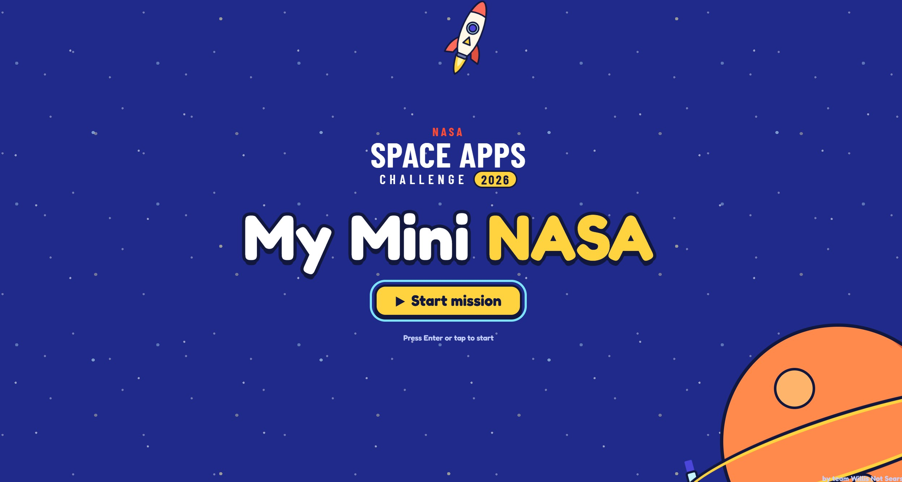
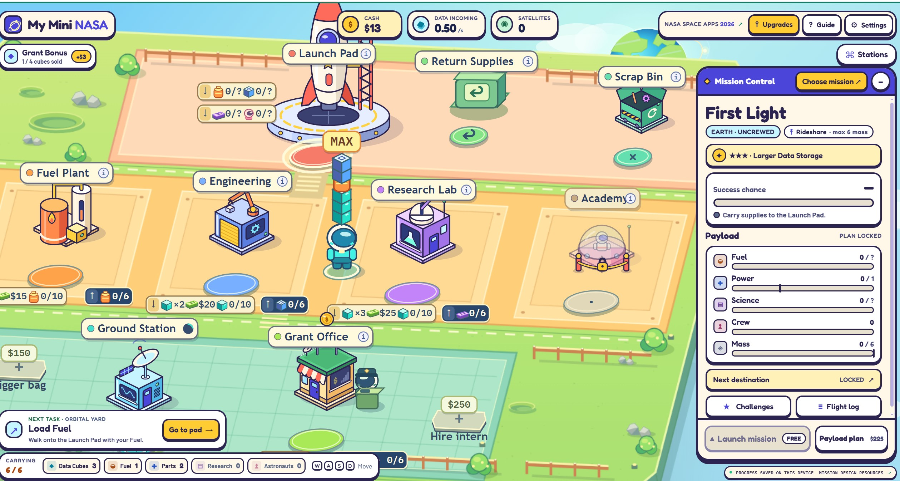
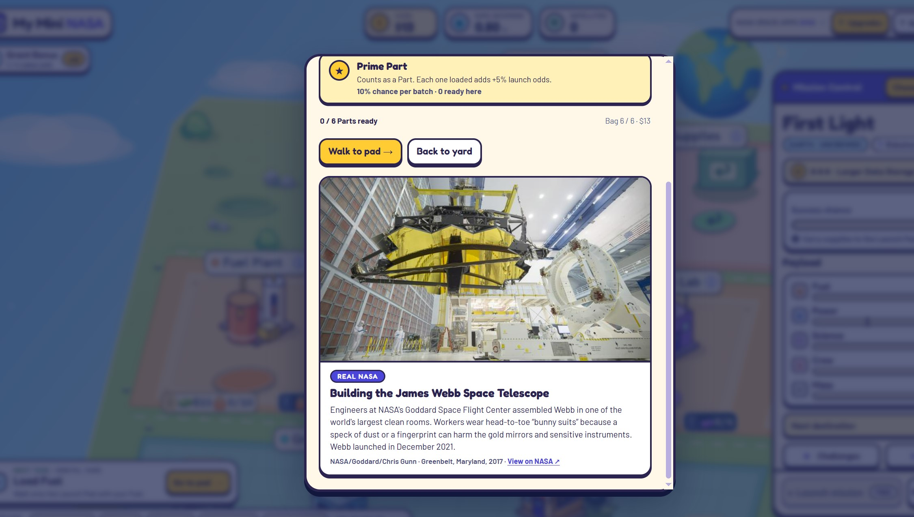
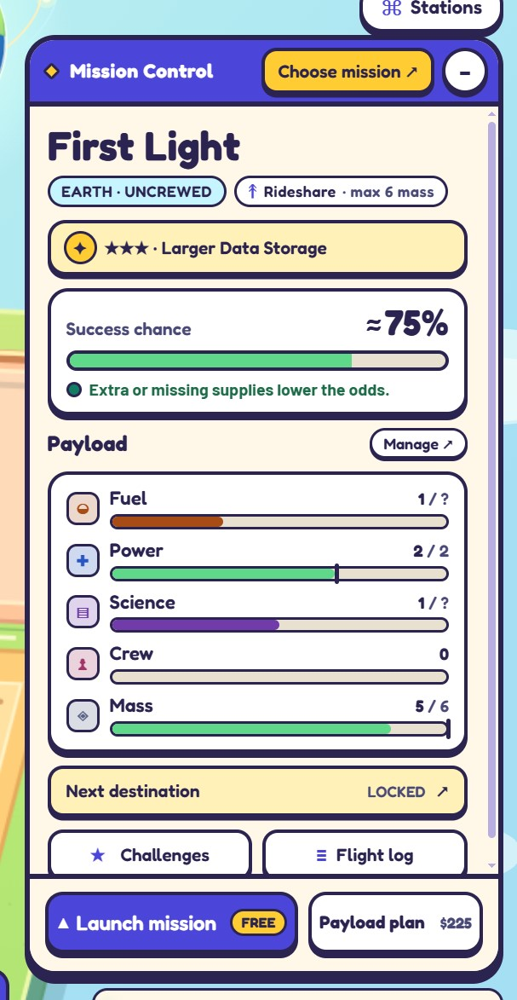
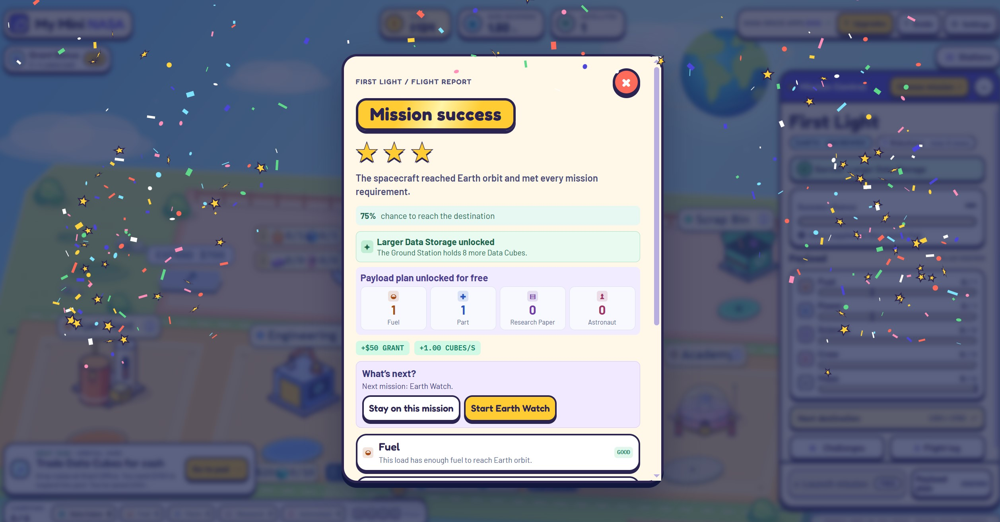
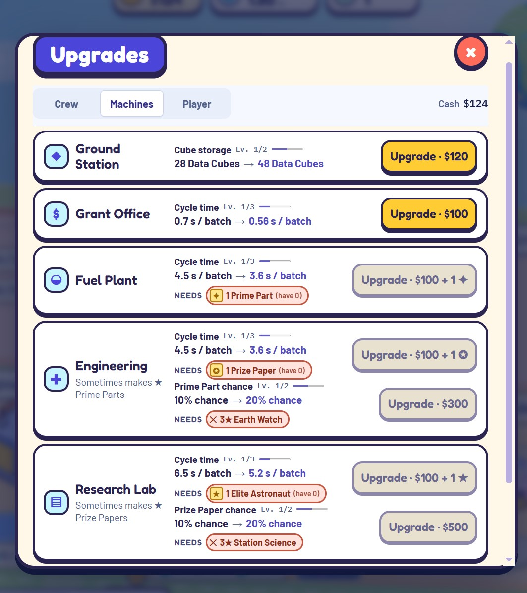

# My Mini NASA

**Run a pocket-sized spaceport, build spacecraft one crate at a time, and launch missions from Earth orbit to the Sun.**

### [▶ Play here: mymininasa.wiki](https://mymininasa.wiki)

<p align="center">
  <a href="https://mymininasa.wiki"></a>
</p>

My Mini NASA is a free browser game built by **team Willis Not Sears** for the [2026 NASA Space Apps Challenge](https://www.spaceappschallenge.org/2026/challenges/space-mission-design-game/), **Space Mission Design Game**. It runs on desktop and mobile with nothing to install.

---

## 1. About the game

### A hypercasual spaceport

My Mini NASA is a hypercasual "walk-and-carry" management game inspired by [My Mini Mart](https://apps.apple.com/us/app/my-mini-mart/id1592004814). In My Mini Mart you run a small shop by carrying goods between stations, hiring helpers, and upgrading. We kept that easy loop and swapped the shop for a spaceport:

- your astronaut walks the yard and carries supplies between facilities,
- satellites send down **Data Cubes**, which the Grant Office turns into funding,
- factories turn data and cash into **Fuel**, **Parts**, **Research Papers**, and **Astronauts**,
- and everything you build ends up on the **Launch Pad**, where you decide what flies.

Anyone can start playing in seconds. The mission design depth shows up gradually, one launch at a time.

### Why a mission design game looks like this

The challenge asks for a game in which players design, manage, and simulate a complete space mission while trading off **mass, power, budget, data, communications, and time**. Mission design is usually taught as theory because students rarely get to run a whole mission from start to finish.

In My Mini NASA, each of those trade-offs is a physical object you have to carry:

- Every Research Paper (instrument) you add raises the science return. It also adds mass and needs another Part (power).
- More mass needs more Fuel, which is the heaviest item of all.
- Loading close to the rocket's limit leaves a thin margin and lowers the odds of success.
- Each launch costs a fee, and the grant for a mission depends on how well it performs.

Players learn the trade-offs by making them, flying the result, and reading a flight report that explains what happened and why.

### How the game maps to the challenge

| Challenge theme | In My Mini NASA |
| --- | --- |
| Define a mission objective | Each of the 11 missions has a stated objective, a destination, and science and crew requirements. |
| Spacecraft design | Parts power the spacecraft, every instrument, and every crew member. Too few Parts means a partial mission. |
| Scientific instruments | Research Papers are instruments. Each mission sets a minimum and a useful maximum. |
| Launch vehicle and orbit | Each mission flies a specific rocket (from Rideshare to Solar heavy launcher) with its own mass limit. Farther destinations need more fuel. |
| **Mass** | Every item has a mass. Going over the limit blocks the launch, and using over 90% of it lowers the odds. |
| **Power** | Parts needed = 1 (spacecraft) + instruments + crew. |
| **Budget** | Cash from grants pays for factories, launch fees, upgrades, and crew. |
| **Data** | Successful satellites keep sending Data Cubes. Better missions downlink more. |
| **Communications** | The Ground Station (modeled on NASA's Deep Space Network) receives every downlink. |
| **Time** | Each factory needs time to produce, so planning the production line matters. |
| Mission simulation and evaluation | Seeded launch evaluation with success odds, a 0 to 3 star rating, and a detailed flight report. |
| Post-mission analysis | The report rates fuel, power, science, crew, and mass, explains the cause of the result, and links a NASA source. |
| Multiple scenarios and difficulty | 11 missions across Earth, Moon, Mars, Sun, Jupiter, Saturn, and Neptune stages, plus adaptive Flight, Operations, and Research challenges. |
| No single perfect solution | Different payload mixes can fly the same mission. A hidden optimal plan rewards experimentation. |
| Save and compare | Progress saves in the browser, and the Flight Log keeps past reports for comparison. |
| Educational value | NASA tips in flight reports, and a "Real NASA" photo card in every facility. |

> **Scope note:** My Mini NASA is single-player. Team play for up to four people, which the challenge suggests as an option, is on our list of future ideas below.

---

## 2. How to play

<p align="center">
  
</p>

### Controls

| Action | Desktop | Mobile |
| --- | --- | --- |
| Move | **WASD** or **arrow keys** | Drag to steer |
| Pick up or deliver | Walk onto a facility pad and wait a moment | Same |
| Open a facility | Click the building | Tap the building |

### The core loop

1. **Collect data.** Pick up Data Cubes at the **Ground Station**.
2. **Get funded.** Drop cubes at the **Grant Office** for $8 each, with a $3 bonus every four cubes.
3. **Build hardware.** Bring cubes and cash to the factories:

   | Facility | Takes | Makes | Real NASA counterpart |
   | --- | --- | --- | --- |
   | Fuel Plant | $15 | 1 Fuel | Liquid hydrogen storage at Launch Pad 39B |
   | Engineering | 2 Data Cubes + $20 | 1 Part | Building the Webb telescope in a clean room |
   | Research Lab | 3 Data Cubes + $25 | 1 Research Paper | Science on the International Space Station |
   | Academy | 4 Data Cubes + $40 | 1 Astronaut | Spacewalk training in the Neutral Buoyancy Laboratory |

4. **Load the rocket.** Carry supplies to the **Launch Pad** and choose exactly how many of each to load.
5. **Launch.** Check the odds in **Mission Control**, then launch. Successful missions add a satellite that keeps sending data, so the loop speeds up.

<p align="center">
  
  <br><sub>Every facility panel ends with a <b>Real NASA</b> card about the place or program it stands for.</sub>
</p>

### Designing a launch



Mission Control shows the payload as gauges for **Fuel, Power, Science, Crew, and Mass**, plus the chance of reaching the destination.

| Item | Mass | Role |
| --- | --- | --- |
| Fuel | 2 | Needed fuel = mission base + 1 per 5 dry mass |
| Part | 1 | Powers the spacecraft, each instrument, and each astronaut |
| Research Paper | 1 | One science instrument |
| Astronaut | 3 | Crew for crewed missions |

- **Over the mass limit:** the launch is blocked.
- **Too little fuel:** the rocket never arrives.
- **Too little power:** the spacecraft arrives but with systems off, which costs stars.
- **Thin margin (90% or more of the limit):** odds drop.
- **Payload plan:** every mission has an optimal mix. Extra and missing supplies both lower the odds. A three-star flight, or flying the exact mix, unlocks the plan for free. You can also buy it.

<br clear="right">

### Missions

The campaign is inspired by real NASA missions, with simplified equipment and flight rules. Tap or hover over **!** on a mission card for a photo, the real flight’s story, and official NASA links. Apollo 11 appears as historical context in the Lunar Program, not as a separate launch.

| # | Mission | Destination | Rocket | Mass limit | Needs | First 3-star perk |
| --- | --- | --- | --- | --- | --- | --- |
| 1 | Explorer 6 | Earth orbit | Rideshare | 6 | A powered satellite | Ground Station holds 8 more cubes |
| 2 | Landsat 1 | Earth orbit | Small | 10 | 1 to 2 instruments | +$2 per Data Cube |
| 3 | TIROS-1 | Earth orbit | Medium | 14 (12 for 3★) | 2 to 3 instruments | Fuel Plant 25% faster |
| 4 | Skylab 2 | Earth orbit | Heavy | 20 | 1 astronaut, 1 to 2 instruments | Bag holds 2 more items |
| 5 | Lunar Orbiter 1 | Lunar orbit | Lunar launcher | 16 | 1 to 2 instruments, uncrewed | Opens the Cargo Shelf |
| 6 | Mariner 9 | Mars orbit | Mars launcher | 18 | 2 instruments | Failed launches refund half the fee |
| 7 | Viking 1 | Mars surface | Mars heavy launcher | 22 (18 for 3★) | 3 to 4 instruments | Factories store 2 more items |
| 8 | Juno | Jupiter orbit | Deep-space launcher | 28 | 4 to 5 instruments, no crew | +1 Data Cube per second |
| 9 | Cassini | Saturn orbit | Outer-planet launcher | 34 | 5 to 6 instruments, ≤29 mass, no crew | +1 Data Cube per second |
| 10 | Voyager 2 | Neptune flyby | Deep-space heavy launcher | 38 | 6 to 7 instruments, no crew | +2 Data Cubes per second |
| 11 | Parker Solar Probe | Solar corona | Solar heavy launcher | 25 | 4 to 5 instruments | +1 Data Cube per second |

A three-star result in a stage lets you buy the next one: **Orbital Yard → Flight Annex → Lunar Program → Mars Program → Jupiter Program → Saturn Program → Neptune Program → Solar Program**.

<p align="center">
  
  <br><sub>A successful launch ends with confetti, a fanfare, and a flight report that explains the result.</sub>
</p>

### Growing the spaceport



- **Crew:** hire a Grant Intern, a Cargo Runner, a Materials Intern, and a Credit Clerk to automate parts of the loop.
- **Machines:** speed up each factory. Speed upgrades cost cash plus a **special product** from the next factory in the chain.
- **Special products:** each batch at Engineering, the Research Lab, or the Academy has a 10% chance to become a **Prime Part** (+5% launch odds), a **Prize Paper** (+30% satellite data), or an **Elite Astronaut** (a bonus of half the mission grant on success). A chance upgrade raises this to 20% after a specific mission is cleared.
- **Player:** a bigger backpack and faster boots.
- **Challenges:** optional Flight, Operations, and Research goals that get harder as you succeed and ease off if you struggle.

<br clear="right">

### The goal

Earn three stars on **Parker Solar Probe**, the final mission, flying through the Sun’s outer atmosphere. Along the way, collect every mission perk and build a fleet of satellites.

### What players learn

- **Everything is connected.** One more instrument means more power, more mass, and more fuel.
- **Margins matter.** A rocket packed to its limit is a riskier rocket.
- **Requirements drive design.** Each mission's objective decides what the payload must include.
- **Destinations cost energy.** Farther targets need more propellant (the rocket equation, simplified).
- **Data is the product.** Missions exist to return science, and better design returns more.
- **Iteration works.** Failed flights explain what went wrong, and real mission teams also compare and refine designs.
- **Real NASA context.** Flight reports cite NASA sources (the rocket equation, CubeSat 101, the Mars Relay Network, Parker Solar Probe, and more), and each facility shows the real NASA place or program behind it.

---

## 3. Technical overview

### Tech stack

| Area | Choice |
| --- | --- |
| Language | Plain JavaScript (ES2020+), HTML, and CSS. No framework and no runtime dependencies. |
| Rendering | HTML Canvas 2D. Every building, character, and rocket is drawn in code as cartoon vector art. There are no sprite sheets. |
| UI | Semantic HTML panels (`<dialog>`, buttons, live regions) layered over the canvas, styled with CSS. |
| Audio | Web Audio API. Background music, the launch rumble, and the fanfare are synthesized live. There are no audio files. |
| Effects | Canvas particles for smoke, sparks, and shockwaves, and a confetti layer drawn in the browser's top layer. |
| Saving | `localStorage`, with migrations for older saves. |
| Randomness | Seeded xorshift generators, so launches and special products are reproducible in tests. |
| Testing | Node's built-in test runner (`node --test`), with no test libraries. |
| Hosting | Cloudflare Pages at mymininasa.wiki. |
| CI | GitHub Actions runs the tests and the static build on every push and pull request. |

### Architecture

The game separates **rules** from **presentation**:

- `rules.js` is a self-contained simulation: the economy, production timers, workers, upgrades, special products, launch evaluation, and saves. It never touches the DOM, so the tests run it directly in Node.
- The other scripts render that state (the canvas yard and HTML panels) and turn player input into rule calls.

```text
input (keys, touch, clicks) ──► app.js ──► rules.js (state + simulation)
                                   │              │
                                   ▼              ▼
                     panels (stations.js, HTML)   yard.js + machines.js (canvas)
```

### Repository structure

```text
my-mini-nasa/
├── index.html          Page shell: HUD, Mission Control, dialogs, splash screen
├── rules.js            Game rules and simulation: economy, missions, launches, upgrades, saves
├── challenges.js       Adaptive Flight, Operations, and Research challenges
├── app.js              Glue: game loop, HUD, panels, launch flow, sound effects
├── yard.js             Canvas yard: movement, camera, pads, workers, particles, launch show
├── machines.js         Cartoon vector drawings of every facility and the rocket
├── stations.js         Facility panels, launch loading, and "Real NASA" cards
├── splash.js           Start screen
├── celebrate.js        Confetti for successful launches
├── music.js            Synthesized background music, one arrangement per destination
├── style.css           Base layout and HUD
├── campaign.css        Mission board and Mission Control layout
├── stations.css        Facility panel layout
├── upgrades.css        Upgrades panel
├── challenges.css      Challenges panel
├── cartoon.css         Cartoon theme for the HUD, panels, and effects
├── splash.css          Start screen styles and animation
├── assets/             README screenshots and facility photos
│   └── nasa/           In-game facility photos from the NASA Image and Video Library
├── tests/              Node tests for rules, economy, crew, campaign, challenges, and specials
├── scripts/build.mjs   Copies the static game into dist/ for deployment
├── .github/workflows/  CI: tests and build on every push and pull request
├── vercel.json         Legacy Vercel configuration (inactive)
└── DEPLOYMENT.md       Hosting and deployment notes
```

### Run it locally

The game is static. Any web server works:

```sh
git clone https://github.com/christianteohx/my-mini-nasa.git
cd my-mini-nasa
python -m http.server 8000      # or: npx serve .
```

Then open http://localhost:8000. Opening `index.html` directly also works, but a server gives the browser a stable origin for saving.

### Test and build

```sh
node --test tests/*.test.cjs    # run the rules tests
node scripts/build.mjs          # package the game into dist/
```

Pushes to `main` deploy automatically after the tests pass. See [DEPLOYMENT.md](DEPLOYMENT.md).

---

## Credits

- **Team:** Willis Not Sears
- **Challenge:** [2026 NASA Space Apps Challenge: Space Mission Design Game](https://www.spaceappschallenge.org/2026/challenges/space-mission-design-game/)
- **Inspiration:** [My Mini Mart](https://apps.apple.com/us/app/my-mini-mart/id1592004814) by Supersonic Studios, for the walk-and-carry gameplay loop. All art, music, and code in My Mini NASA are original.
- **Mission design reference:** [NASA, Design and Develop Science Missions](https://www.nasa.gov/wp-content/uploads/2025/04/250323-design-and-develop-science-mission.pdf)

### NASA photos

Each facility panel ends with a "Real NASA" card. The photos in `assets/nasa/` are small renditions from the [NASA Image and Video Library](https://images.nasa.gov/), used under the [NASA Images and Media Usage Guidelines](https://www.nasa.gov/nasa-brand-center/images-and-media/). Credits and library IDs also appear with the captions in `stations.js`.

| Facility | NASA counterpart | Library ID |
| --- | --- | --- |
| Ground Station | Deep Space Network, Goldstone | PIA23214 |
| Grant Office | Mary W. Jackson NASA Headquarters | NHQ202102260022 |
| Fuel Plant | Liquid hydrogen sphere, Pad 39B | KSC-20230613-PH-KLS02_0033 |
| Engineering | Webb telescope in the Goddard clean room | GSFC_20171208_Archive_e000270 |
| Research Lab | Combustion Integrated Rack, space station | iss058e026380 |
| Academy | Neutral Buoyancy Laboratory spacewalk training | jsc2005e04330 |
| Scrap Bin | Space station water recovery system | iss072e143163 |
| Launch Pad | Artemis I at Launch Complex 39B | KSC-20220915-PH-JNP01_0001 |
| Cargo Shelf | Cygnus cargo craft arriving at the station | iss071e416851 |
| Returns | CRS-21 science unpacked after splashdown | KSC-20210114-ILW02_0044 |

My Mini NASA is a fan-made educational project. It is not affiliated with or endorsed by NASA or Supersonic Studios. The missions use simplified game units.

## Future ideas

- Team mode for up to four players with roles (mission planning, spacecraft, science, communications)
- Random in-flight events and unexpected constraints
- Leaderboards and shareable mission designs
- A sandbox mode with no budget limits

## Release history

| Release | Changes |
| --- | --- |
| Current (`main`) | Cartoon art and UI, Real NASA facility cards, start screen, special products and chained upgrades, slower production for more challenge, launch show with confetti and fanfare, and synthesized background music. |
| v11 | Rebalanced income and added adaptive challenges for Flight, Operations, and Research. |
| v10 | Spaced out the yard and station labels, removed the Grant Officer tag, and simplified the Upgrades menu. |
| v9 | Renamed the game to My Mini NASA. |
| v8 | Centered follow camera, station signs, staffed Grant Office, four upgradeable crew roles, mission perks, and one-row payload transfers. |
| v7 | Walk-up yard actions, Return Supplies pad, and idle Intern animation at a full Grant Office. |
| v6 | Exact quantities at the Launch Pad, one-click actions elsewhere, and a clearer Grant Bonus counter. |
| v5 | Exact item quantities, facility panels, free payload plans after success, and missions to the Moon, Mars, and the Sun. |
| v4 | One pad per station for drop-off and pickup. |
| v3 | Full-window yard, collapsible Mission Control, mission choice, Flight Annex, and hidden recipes. |
| v2 | Brighter yard, scientist orders, walk-up upgrades, and Cargo Runner. First public release. |
| v1 | First playable release, with four Earth-orbit missions. |

